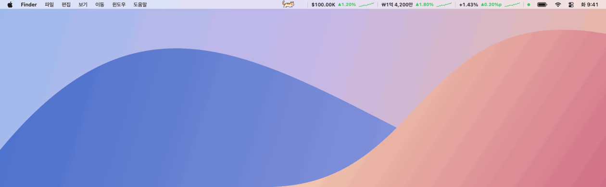
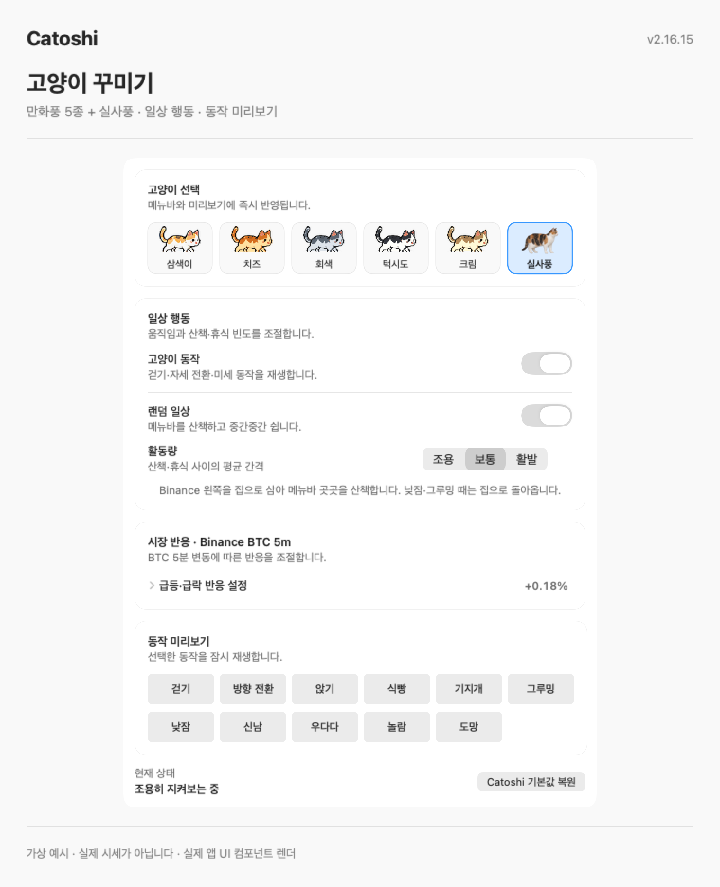
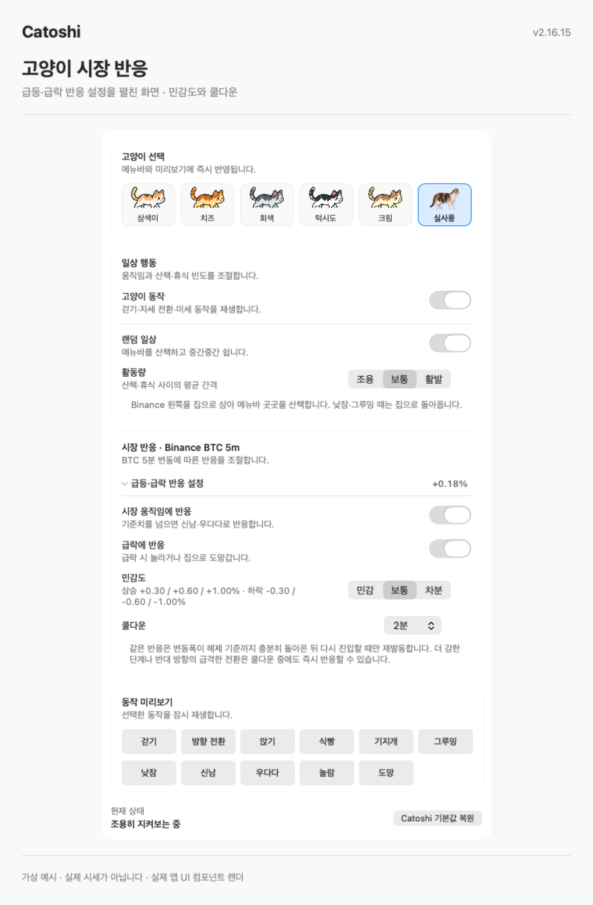
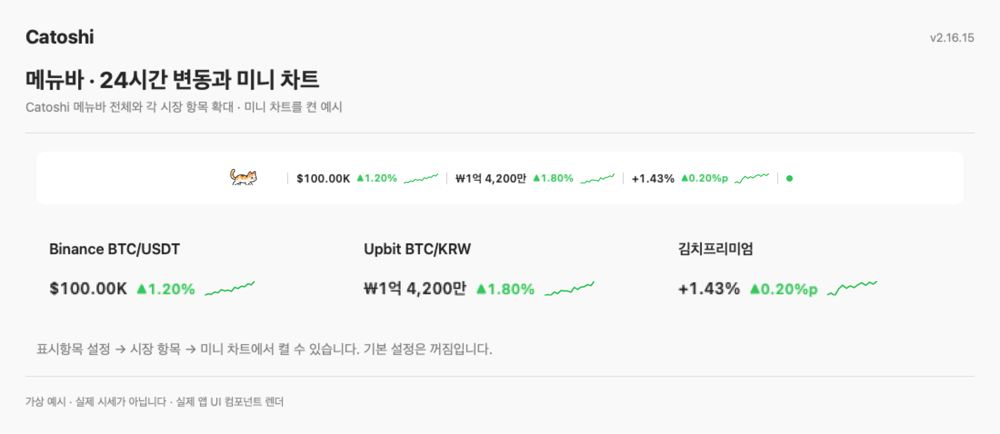
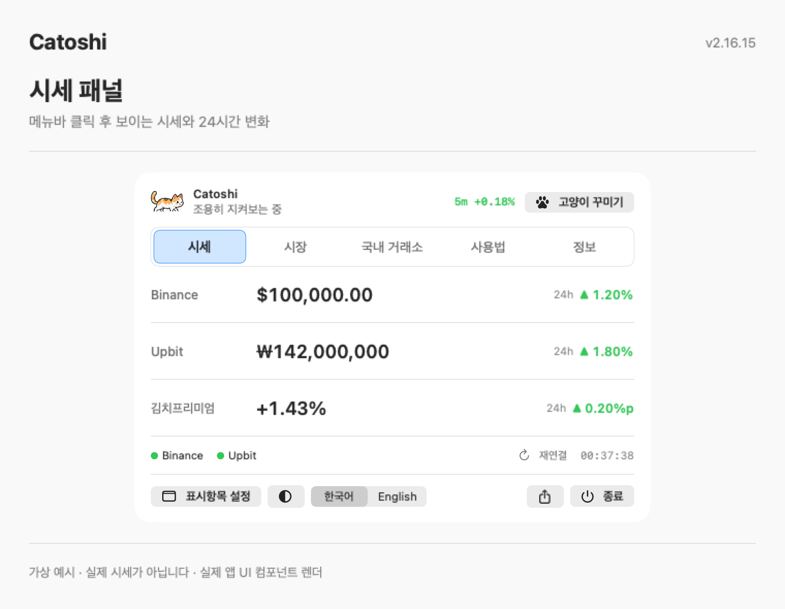
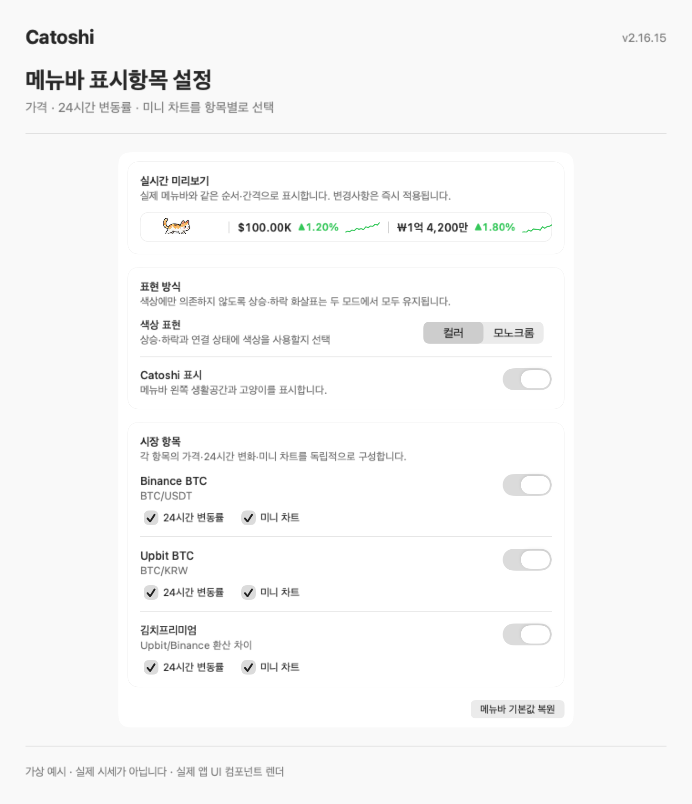
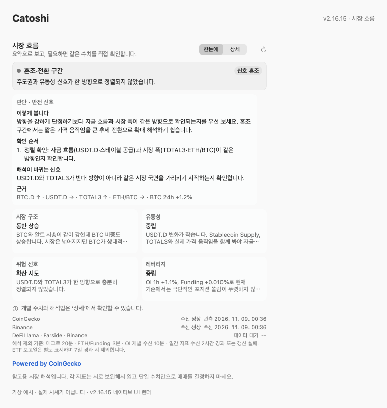
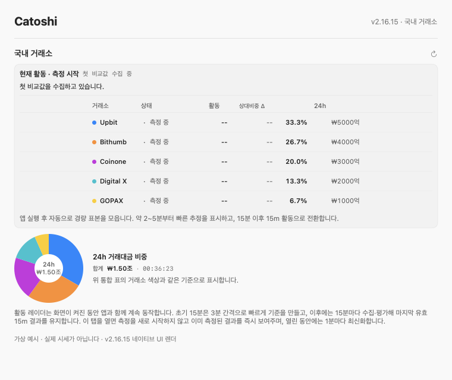
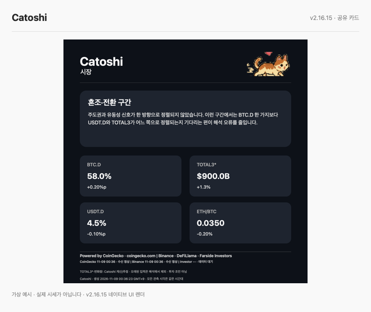
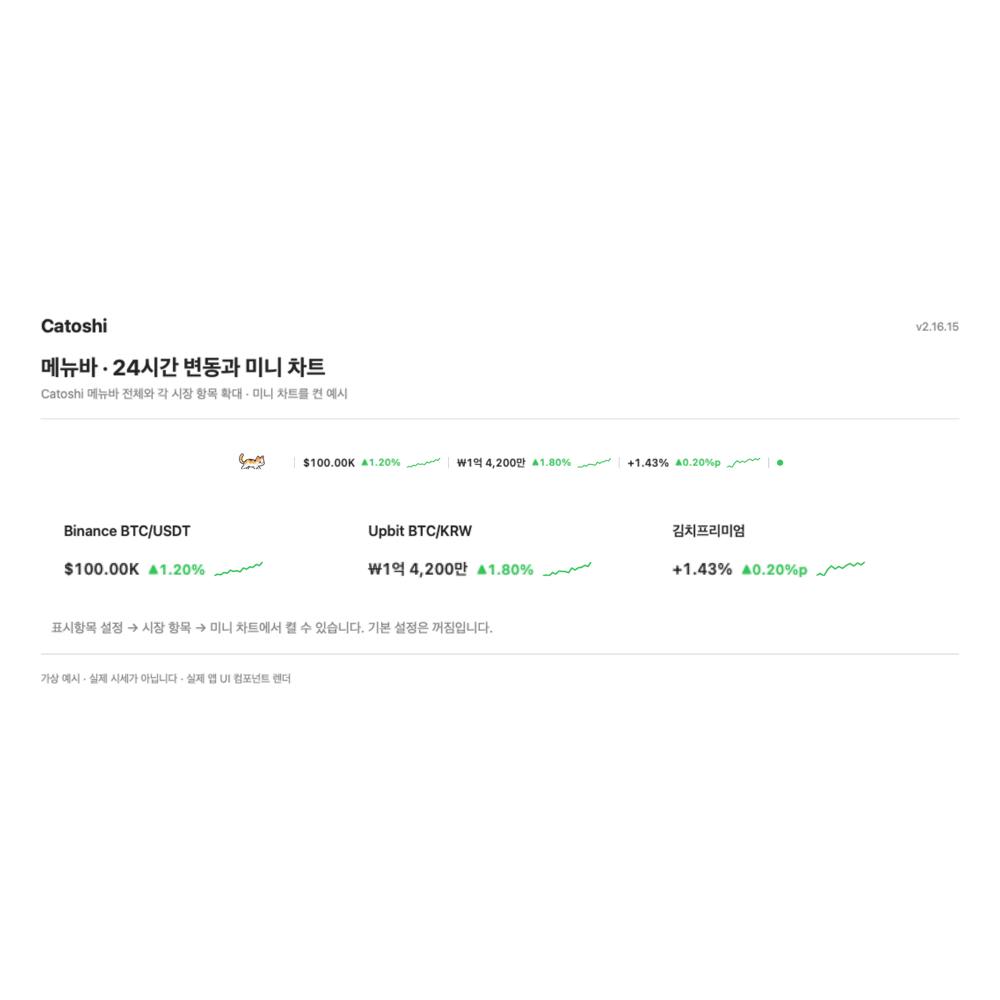

# Catoshi 🐈

**메뉴바에 사는 작은 고양이, Catoshi.**

Mac 메뉴바를 걷다가 낮잠도 자고, 가끔 우다다도 하는 고양이입니다. 고양이 옆에서 비트코인 시세와 김치프리미엄을 확인할 수 있습니다.



*메뉴바 화면을 재현한 예시입니다. 숫자는 실제 시세가 아닙니다.*

macOS 13 이상에서 사용할 수 있으며, 소스를 받아 자신의 Mac에서 직접 빌드합니다. **비상업적 개인 사용만 허용합니다.**

A cat in your Mac menu bar, with Bitcoin prices and Korean market data. Source-available for non-commercial personal use.

**v2.16.17 · 정식 출시** · [변경 이력](docs/CHANGELOG.md) · [설치 가이드](docs/BUILDING.md)

## 할 수 있는 것

- 만화풍 고양이 5종과 실사풍 삼색 고양이 중에서 고르기
- 산책·낮잠·그루밍을 구경하고, BTC 급등락에 대한 고양이 반응 조절하기
- Binance BTC/USDT, Upbit BTC/KRW, 김치프리미엄과 미니 차트를 메뉴바에서 보기
- 시장 지표와 국내 5개 거래소의 거래 활동 살펴보기
- 시세와 시장 수치가 담긴 공유 카드 만들기

## 설치

**전체 Xcode 앱은 필요 없습니다.** Command Line Tools와 Swift 5.9 이상이 있으면 빌드할 수 있습니다. 이미 준비돼 있다면 추가로 설치할 도구는 없습니다.

완성된 `.app`이나 `.dmg` 대신 소스를 배포합니다. 아래 순서대로 진행하거나, 터미널이 처음이라면 [자세한 설치 가이드](docs/BUILDING.md)를 참고하세요.

### 1. 소스 받기

[GitHub Releases](https://github.com/Rayeonjin/Catoshi/releases)에서 원하는 버전의 **Source code (zip)**을 받아 압축을 풉니다. `Code → Download ZIP`에는 개발 중인 변경이 들어갈 수 있으니, 설치할 때는 릴리스 ZIP을 권장합니다.

### 2. 빌드 도구 확인하기

Spotlight에서 **터미널**을 열고 실행합니다.

```bash
xcrun swift --version
```

Swift 5.9 이상의 버전이 나오면 다음 단계로 넘어가세요. 도구가 없다는 오류가 나오면 아래 명령으로 **Command Line Tools만** 설치합니다.

```bash
xcode-select --install
```

이 명령은 Xcode 앱을 설치하는 명령이 아닙니다. 설치가 끝나면 `xcrun swift --version`을 다시 확인하세요. [Apple의 설치 안내](https://developer.apple.com/documentation/xcode/installing-the-command-line-tools/)도 참고할 수 있습니다.

### 3. 빌드하고 실행하기

터미널에 `cd `를 입력하고, 압축을 푼 폴더를 끌어다 놓은 뒤 Enter를 누릅니다. 이어서 실행합니다.

```bash
cat VERSION
bash setup.sh
```

`cat VERSION`으로 받은 소스의 버전을 확인할 수 있습니다. 빌드가 끝나면 `~/Applications/Catoshi.app`에 설치되고, 화면 맨 위 **메뉴바**에 고양이가 나타납니다.

Homebrew, 거래소 API Key, 유료 Apple Developer 계정은 필요하지 않습니다.

## 업데이트와 복구

앱에서 **정보 → 업데이트 확인**을 누르면 새 정식·베타 버전이 있는지 확인할 수 있습니다. 버튼을 누를 때만 GitHub에 접속합니다. 새 버전을 자동으로 내려받거나 설치하지는 않습니다. [확인 화면 예시](docs/images/update-check.png)

업데이트할 때도 새 릴리스의 **Source code (zip)**을 별도 폴더에 풀고 `bash setup.sh`를 실행하면 됩니다. 기존 앱을 먼저 지울 필요는 없습니다. 설정과 거래소 활동 기록은 유지하며, 직전 앱은 `~/Applications/Catoshi.previous.app`에 보관합니다.

새 버전에 문제가 생기면 [이전 앱으로 복구하는 방법](docs/BUILDING.md#이전-앱으로-복구)을 따라 주세요. 복구는 앱 버전만 되돌리며, 설정과 기록을 과거 시점으로 바꾸지는 않습니다.

## 화면 둘러보기

아래 이미지는 앱과 같은 UI로 만든 화면 예시입니다. 숫자는 가상 데이터이며, 메뉴바 장면은 데스크톱 구성을 재현했습니다. [이미지 제작 방식](docs/images/README.md)

### 메뉴바의 고양이

고양이는 Catoshi 영역 안을 산책하다가 멈춰 서거나, 앉거나, 식빵 자세로 쉽니다.


메뉴바를 누르고 **고양이 꾸미기**를 열면 고양이 종류와 활동량을 바꿀 수 있습니다. 걷기·기지개·그루밍·낮잠 등의 동작도 미리 볼 수 있습니다. 실사풍 고양이는 사진처럼 보이도록 생성한 이미지입니다.



**급등·급락 반응 설정**에서는 BTC 5분 변동에 대한 반응, 민감도와 반응 사이의 대기 시간을 조절합니다.



[실사풍 포즈 원본과 아틀라스 재생성 방법](artwork/realistic/README.md)

### 시세와 미니 차트

BTC 가격, 24시간 변동, 김치프리미엄을 메뉴바에서 볼 수 있습니다. **미니 차트는 기본으로 꺼져 있습니다.** `표시항목 설정 → 시장 항목 → 미니 차트`에서 켜세요.



메뉴바를 누르면 시세 패널이 열립니다. Binance·Upbit 이름을 누르면 해당 BTC 거래 화면으로 이동합니다. 거래소명에 마우스를 올리면 글자가 굵고 커집니다.



**표시항목 설정**에서 가격·24시간 변동·차트를 각각 켜고 끌 수 있습니다. 색상과 고양이 표시 여부도 바꿀 수 있고, 상단 미리보기는 가로로 스크롤됩니다.



### 시장 흐름

BTC.D·TOTAL3·ETH/BTC·OI·Funding 등을 함께 살펴봅니다. ‘한눈에’에서는 시장 확대를 지지하는 근거와 엇갈리는 신호를 실제 수치와 함께 보여 줍니다. 현물 수요·중기 추세·국내 심리·가격을 따로 읽고, 빠진 데이터와 다음에 확인할 변화도 확인할 수 있습니다.



### 국내 거래소

국내 5개 거래소의 거래대금 비중과 Activity Radar를 보여 줍니다. 거래소 이름을 누르면 공식 사이트가 열립니다.



### 공유 카드

BTC·김치프리미엄·시장 지표·국내 거래소 수치를 카드로 만들 수 있습니다. Feed / Story / Square 중에서 골라 이미지와 캡션을 복사하거나, PNG로 저장하거나, macOS 공유 메뉴로 보낼 수 있습니다.



<details>
<summary>전체 화면 둘러보기 · 약 28초</summary>



</details>

## 문의와 버그 제보

- [GitHub](https://github.com/Rayeonjin/Catoshi): 소스, 릴리스, 설치 문서와 버그 제보
- [Telegram](https://t.me/Rayeonjin): 업데이트 공지와 간단한 문의

문제가 생기면 [문제 해결 문서](docs/TROUBLESHOOTING.md)를 먼저 확인해 주세요. 해결되지 않으면 앱 버전, macOS와 칩 종류, 설치 방법(ZIP/Git), 막힌 단계와 오류 메시지를 함께 알려 주세요. 현재 공개 버전에서 재현되는 문제를 중심으로 살펴봅니다. 개인 프로젝트라 답변이 늦어질 수 있습니다.

## 개발 응원하기

이 앱을 만드는 Studio RAYEONJIN의 개발 활동을 후원으로 응원하실 수 있습니다.

[Fairy](https://fairy.hada.io/@studio-rayeonjin) · [Buy Me a Coffee](https://buymeacoffee.com/rayeonjin) · [Ko-fi](https://ko-fi.com/rayeonjin)

후원은 특정 앱에 한정되지 않고 스튜디오의 개발 활동 전반에 대한 자발적인 응원입니다. 앱의 사용 조건이나 기능, 업데이트·문의 응답에 후원 여부에 따른 차이를 두지 않습니다.

## 데이터와 개인정보

시세는 각 제공자의 공개 API에서 직접 받아 옵니다. 거래소 로그인, API Key, 지갑 키나 거래 계정 정보를 입력할 필요는 없습니다. 업데이트 확인 버튼을 누르면 GitHub에도 접속하며, 계정·기기 식별정보·사용 기록은 전송하지 않습니다.

데이터가 늦게 도착하거나 갱신에 실패하면 화면에 상태를 표시합니다. 오래된 값은 자동 해석에서 제외하고, 공유 카드에도 출처·기준 시각과 추정 여부, 일부 데이터만 수신됐는지를 표시합니다. 시장 해석은 참고용이며 투자자문이나 매매 권유가 아닙니다.

공유 카드에도 데이터 제공자의 이용 조건이 적용됩니다. Catoshi의 사용 허가가 제3자 데이터의 수집·가공·표시·재공유 허가까지 뜻하지는 않습니다. 확인한 조건과 아직 확인하지 못한 부분은 [데이터 출처](docs/DATA_SOURCES.md)에 정리했습니다.

[갱신 주기와 캐시 정책](docs/RESOURCE_USAGE.md)

## 지원 환경

- macOS 13 이상
- Apple Silicon 또는 Intel Mac
- Swift 5.9 이상을 포함한 Command Line Tools

지금 쓰는 Mac의 아키텍처에 맞춰 빌드합니다. 릴리스별로 확인한 빌드·실행 환경은 각 릴리스 기록을 참고하세요.

## 라이선스

Catoshi는 **비상업적 개인 사용만 허용하는 소스 공개(source-available) 프로젝트**입니다. OSI 승인 오픈소스 라이선스는 아닙니다.

비상업적 개인 용도로 빌드·사용·수정할 수 있으며, 개인적인 학습·연구도 포함합니다. 같은 조건으로 소스를 무료 공유할 수 있고, 공유할 때는 라이선스·저작권 고지와 수정 내용을 유지해야 합니다.

회사 내부 업무·모니터링, 기관 교육·연구, 고객 작업, 실행파일 재배포, 상업적 판매·서비스 제공에는 사전 서면 허가가 필요합니다. 자세한 조건은 [LICENSE](LICENSE)를 확인하세요.

## 문서

- [설치·업데이트·복구](docs/BUILDING.md)
- [문제 해결](docs/TROUBLESHOOTING.md)
- [시장 해석 기준](docs/MARKET_INTERPRETATION.md)
- [리소스·갱신 정책](docs/RESOURCE_USAGE.md)
- [데이터 출처](docs/DATA_SOURCES.md)
- [보안](.github/SECURITY.md)
- [기여 방법](.github/CONTRIBUTING.md)
- [변경 이력](docs/CHANGELOG.md)
- [제3자 고지](docs/THIRD_PARTY_NOTICES.md)
